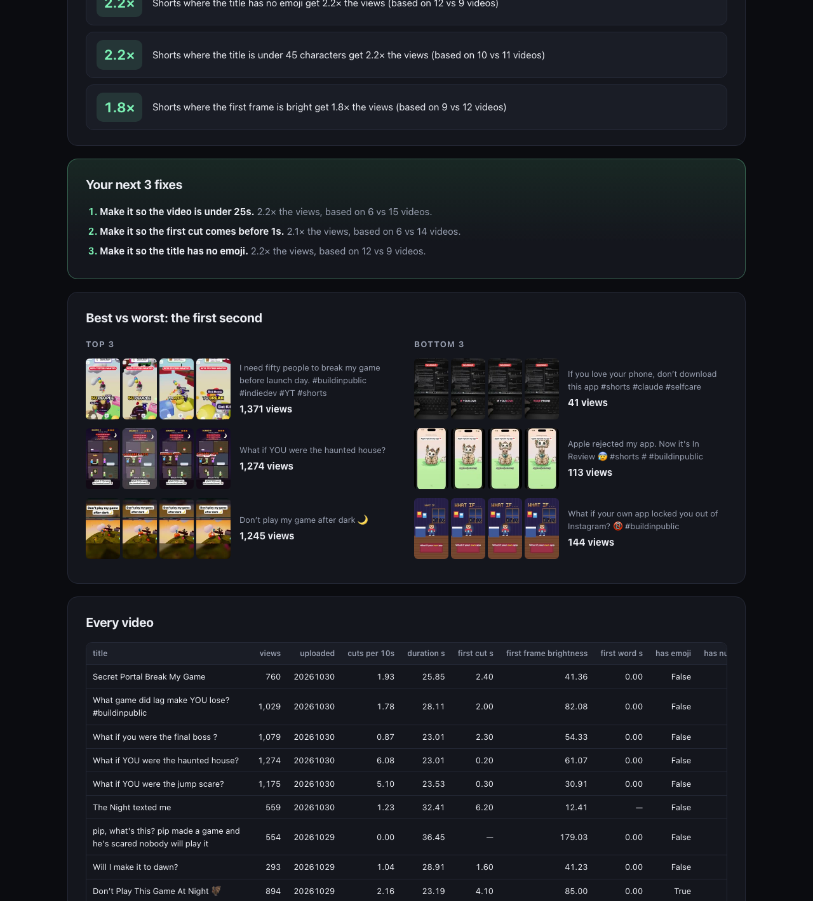

# Hitprint

**Find the fingerprint of your hits.** Hitprint looks at your own short videos and tells you what your best ones have in common: a fast first cut, a short title, a bright first frame, a question in the title. It measures every video, compares your top performers with the rest, and gives you a short list of rules plus your next 3 fixes.

It works on YouTube Shorts from a channel handle, and on TikTok, Reels or any other platform from a folder of your video files plus a stats export.



> Patterns from your own videos, not proof. Hitprint finds what your hits share. It doesn't claim that changing one thing will cause more views.

## What you get

Each run writes three files to `./hitprint-out/`:

| File | What it is |
|---|---|
| `hitprint-report.html` | Your top 5 rules, your next 3 fixes, first-second filmstrips of your best and worst videos, and a table of every video |
| `my-formula.md` | Your rules written as instructions you can paste into any AI scriptwriter |
| `hitprint-data.json` | Every measurement, for your own analysis |

Each rule shows its sample size, for example *"Shorts where the first cut comes before 1s get 2.1× the views (based on 6 vs 14 videos)"*.

## Install

You need Python 3.11+ and these tools on your PATH:

- [`ffmpeg`](https://ffmpeg.org/) (includes `ffprobe`): required
- [`yt-dlp`](https://github.com/yt-dlp/yt-dlp): required for YouTube mode
- [`whisper`](https://github.com/openai/whisper): optional, used for the "seconds to first word" check

```bash
# macOS
brew install ffmpeg yt-dlp
pipx install openai-whisper        # optional

# Hitprint itself (no Python dependencies)
pipx install git+https://github.com/SOULGPT/hitprint
```

**As an agent skill** (Claude Code, Codex and others):

```bash
npx skills add SOULGPT/hitprint
```

Then ask your agent *"find my hitprint"* or *"what do my best videos have in common?"*. It runs the CLI and walks you through the results.

## Usage

**1. A YouTube channel**

```bash
hitprint @yourhandle --open
```

Hitprint lists your public Shorts, downloads them at 360p (cached in `hitprint-out/cache`), measures them and opens the report. If YouTube shows a bot check, add `--cookies-from-browser chrome`.

**2. Score by retention instead of views**

```bash
hitprint @yourhandle --studio studio-export.csv
```

Export your Shorts table from YouTube Studio. Hitprint then ranks videos by *stayed to watch* instead of views.

**3. Any platform: a folder plus stats**

```bash
hitprint --folder ./my-videos --stats tiktok-export.csv
```

The stats file can be CSV or XLSX. Hitprint recognizes common headers (`Video Views`, `Plays`, `Post time`, `Caption`…) and number formats (`1.2K`, `1,234`, `12%`). Rows are matched to files by a `file` column, or by date plus duration. If you have no export, fill in [`templates/stats-template.csv`](templates/stats-template.csv).

Other options:

| Flag | Default | What it does |
|---|---|---|
| `--out DIR` | `./hitprint-out` | where outputs and the download cache go |
| `--no-whisper` | off | skip the first-word check |
| `--open` | off | open the report when done |

## What it measures

- **Editing:** seconds to the first spoken word, time of the first cut, longest shot, cuts per 10 seconds, loudness (LUFS), first-frame brightness, how well the last frame loops to the first, and length.
- **Title:** length, says "you", is a question, has a number, has an emoji, and series prefix.
- **Posting:** upload weekday and hour.

Each feature splits your videos into two groups. A rule is reported only when **both groups have at least 5 videos** and the better group's median score is **at least 1.3×** the other's. Rules are ranked by effect size times a bootstrap confidence check.

## Privacy

Everything runs on your machine. Hitprint reads public YouTube data (no login unless you pass `--cookies-from-browser`) or your local files, and it uploads nothing.

## Limits

- You need **at least 10 usable videos**. With fewer, Hitprint exits and tells you how many it found.
- Videos younger than **3 days** are skipped because their views are still settling.
- With 10–30 videos, effects are rough. Treat rules as hunches to test, not laws. If no rule passes the bar, the report says *"No clear patterns yet"* instead of inventing one.
- It finds correlation, not causation. Your best videos may share a trait because of the topic, the timing or luck.
- YouTube may rate-limit downloads. Hitprint waits at least 2s between downloads, retries a bot check 3 times, then carries on and lists the failed videos in the report.

## Development

```bash
python -m venv .venv && .venv/bin/pip install -e . pytest
.venv/bin/python -m pytest -q
```

## License

[MIT](LICENSE)
